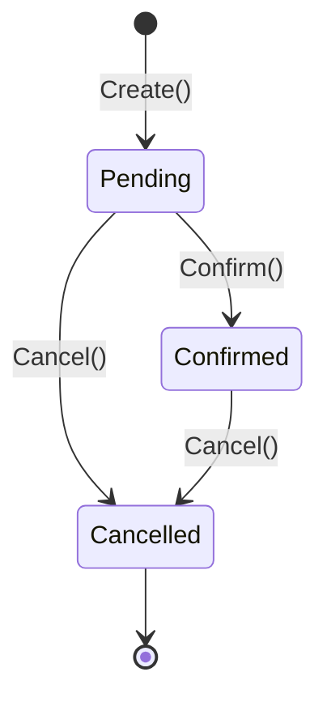
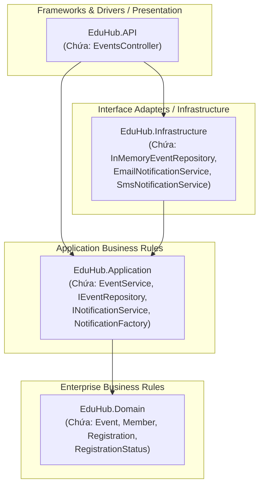

# BÀI THI GIỮA HỌC PHẦN - PHÁT TRIỂN PHẦN MỀM HƯỚNG ĐỐI TƯỢNG (IN4211)
- **Học kỳ:** 1, năm học 2026 – 2027
- **Họ và tên:** Nguyễn Quốc Lợi
- **MSSV:** 0024419238
- **Nhánh làm bài:** `midterm/0024419238`

---

## Câu 1a
**Bốn trụ cột của lập trình hướng đối tượng (OOP):**

1. **Đóng gói (Encapsulation):**
   - *Giải thích ngắn gọn:* Gom nhóm dữ liệu (thuộc tính) và các hành vi (phương thức) thao tác trên dữ liệu đó vào trong một đơn vị (lớp), đồng thời che giấu trạng thái bên trong để ngăn chặn sự truy cập hoặc sửa đổi trực tiếp từ bên ngoài mà không qua kiểm soát.
   - *Minh hoạ trong bài làm:*
     - Tệp: `Member.cs` (hoặc `Registration.cs`)
     - Lớp: `Member` trong project `EduHub.Domain` (các thuộc tính `Id`, `Email` có `private set`, constructor `private` và cung cấp factory method `Create(...)` có kiểm tra hợp lệ).

2. **Trừu tượng (Abstraction):**
   - *Giải thích ngắn gọn:* Tập trung vào các đặc tính và hành vi cốt lõi của đối tượng đối với bên ngoài mà ẩn đi chi tiết cài đặt phức tạp bên trong, thường được thể hiện qua các interface hoặc abstract class.
   - *Minh hoạ trong bài làm:*
     - Tệp: `IEventRepository.cs` (hoặc `INotificationService.cs`)
     - Lớp / Interface: `IEventRepository` trong project `EduHub.Application` (định nghĩa các hành vi thao tác dữ liệu sự kiện mà không phụ thuộc vào cơ chế lưu trữ cụ thể).

3. **Kế thừa (Inheritance):**
   - *Giải thích ngắn gọn:* Cho phép một lớp mới (lớp con) tái sử dụng các thuộc tính, phương thức của một lớp đã có (lớp cha), giúp tăng khả năng tái sử dụng mã nguồn và thể hiện mối quan hệ "is-a".
   - *Minh hoạ trong bài làm:*
     - Tệp: `EventsController.cs`
     - Lớp: `EventsController` kế thừa từ `ControllerBase` của ASP.NET Core trong project `EduHub.API`.

4. **Đa hình (Polymorphism):**
   - *Giải thích ngắn gọn:* Cho phép các đối tượng thuộc các lớp khác nhau phản ứng theo những cách khác nhau đối với cùng một thông điệp (lời gọi phương thức), cùng một kiểu giao diện chung.
   - *Minh hoạ trong bài làm:*
     - Tệp: `EmailNotificationService.cs` và `SmsNotificationService.cs`
     - Lớp: `EmailNotificationService` và `SmsNotificationService` trong project `EduHub.Infrastructure` (cùng hiện thực interface `INotificationService` với cách gửi thông báo khác nhau).

---

## Câu 1b
**Hai vấn đề trong lớp `Member` ban đầu chưa đóng gói:**
1. **Thiếu sự bảo vệ trạng thái thuộc tính (Public Setters):** Các thuộc tính `Id` và `Email` đều có setter công khai (`public get; set;`), cho phép bất kỳ đối tượng bên ngoài nào cũng có thể tự do gán đè dữ liệu bất kỳ lúc nào mà không qua bất kỳ sự kiểm tra tính hợp lệ nào (ví dụ: `m.Email = "abc";` dù email không đúng định dạng).
2. **Không kiểm soát việc khởi tạo đối tượng hợp lệ:** Lớp cung cấp constructor rỗng công khai (`public Member() { }`), cho phép khởi tạo một thực thể `Member` ở trạng thái không hoàn chỉnh (ví dụ `Id` rỗng, `Email` rỗng hoặc null) mà không có ràng buộc nghiệp vụ lúc tạo đối tượng.

---

## Câu 2a
**Sơ đồ trạng thái của `Registration`:**



*Ghi chú:* Phiếu đã ở trạng thái `Cancelled` thì không thể chuyển sang bất kỳ trạng thái nào khác (kể cả gọi `Confirm()` hay `Cancel()`).

---

## Câu 3a
**Ba nguyên lý SOLID mà lớp `EventService` ban đầu vi phạm:**

1. **Single Responsibility Principle (SRP - Đơn trách nhiệm):**
   - *Dòng vi phạm:* Dòng 6 – 14.
   - *Giải thích:* Lớp `EventService` và phương thức `CreateEvent` gánh vác quá nhiều trách nhiệm khác nhau: vừa kiểm tra hợp lệ dữ liệu (validation), vừa trực tiếp kết nối và lưu cơ sở dữ liệu (`SqlConnection`), vừa ghi nhật ký file (`File.AppendAllText`), vừa gửi thông báo qua email hoặc SMS. Có quá nhiều lý do khiến lớp này bị sửa đổi khi một trong các tác vụ trên thay đổi.

2. **Open/Closed Principle (OCP - Mở cho mở rộng, đóng cho sửa đổi):**
   - *Dòng vi phạm:* Dòng 11 – 14 (`if (channel == "email") ... else if (channel == "sms") ...`).
   - *Giải thích:* Khi muốn mở rộng thêm một kênh thông báo mới (ví dụ Telegram, Zalo), ta buộc phải sửa đổi trực tiếp vào code của phương thức `CreateEvent` bằng cách thêm các nhánh `else if`, thay vì chỉ cần mở rộng lớp mới.

3. **Dependency Inversion Principle (DIP - Đảo ngược phụ thuộc):**
   - *Dòng vi phạm:* Dòng 8, 12, 14 (`new SqlConnection(...)`, `new EmailSender()`, `new SmsSender()`).
   - *Giải thích:* Module cấp cao `EventService` đang trực tiếp phụ thuộc vào các module/lớp cài đặt cụ thể ở cấp thấp (`SqlConnection`, `EmailSender`, `SmsSender`) thay vì phụ thuộc vào các abstraction (interface). Điều này gây thắt chặt phụ thuộc (tight coupling) và không thể viết unit test độc lập.

---

## Câu 4b
**Phân biệt `git merge` và `git rebase`. Khi nào không nên dùng rebase?**

1. **Phân biệt `git merge` và `git rebase`:**
   - **`git merge`:** Gộp hai nhánh lại với nhau bằng cách tạo ra một commit gộp mới (merge commit) có hai commit cha. Lịch sử commit gốc của cả hai nhánh được bảo toàn nguyên vẹn theo đúng trình tự thời gian, thể hiện rõ các nhánh rẽ và hợp nhất.
   - **`git rebase`:** Lấy các commit trên nhánh hiện tại và "áp dụng lại" (re-apply) từng commit đó lên đỉnh của nhánh đích. Quá trình này viết lại lịch sử commit (tạo các mã hash commit mới), tạo ra một chuỗi commit thẳng, liền mạch và gọn gàng như thể công việc được làm tuần tự.

2. **Khi nào không nên dùng `git rebase`?**
   - Tuân theo **Quy tắc vàng của Rebase (The Golden Rule of Rebasing):** Tuyệt đối **không rebase trên các nhánh công khai (public branch)** đã được đẩy (push) lên remote repository mà nhiều thành viên khác đang cùng làm việc dựa trên đó (ví dụ nhánh `main`, `develop`).
   - *Lý do:* Vì rebase viết lại lịch sử (thay đổi commit hash), nếu người khác pull về sẽ gặp xung đột lịch sử nghiêm trọng, gây rối loạn mã nguồn của cả nhóm và buộc phải force-push (`git push --force`).

---

## Câu 5a
**Sơ đồ 4 lớp của Clean Architecture và chiều phụ thuộc:**



**Phân bổ các thành phần trong đề bài vào 4 project:**
- `Event`: thuộc `EduHub.Domain` (Entities)
- `IEventRepository`: thuộc `EduHub.Application` (Interfaces/Repositories)
- `EventService`: thuộc `EduHub.Application` (Services)
- `InMemoryEventRepository`: thuộc `EduHub.Infrastructure` (Repositories)
- `EventsController`: thuộc `EduHub.API` (Controllers)

---

## Câu 5b
**Giải thích vì sao project `EduHub.Domain` không được tham chiếu tới `EduHub.Infrastructure`:**
- Theo nguyên lý **Dependency Rule** của Clean Architecture, chiều phụ thuộc của mã nguồn luôn phải hướng vào tâm (từ các tầng ngoài hướng vào các tầng trong).
- `EduHub.Domain` là tầng trung tâm (Enterprise Business Rules), chứa các thực thể và quy tắc nghiệp vụ cốt lõi nhất của hệ thống. Nó phải hoàn toàn độc lập với công nghệ, cơ sở dữ liệu, framework, giao diện và các dịch vụ bên ngoài.
- Nếu `EduHub.Domain` tham chiếu tới `EduHub.Infrastructure`, tầng nghiệp vụ cốt lõi sẽ bị phụ thuộc chặt chẽ vào chi tiết triển khai công nghệ (như cách lưu trữ InMemory, cơ sở dữ liệu SQL, gửi mail/sms,...). Khi công nghệ hạ tầng thay đổi, Domain sẽ bị ảnh hưởng, làm mất đi tính độc lập, tính bền vững và khả năng kiểm thử của hệ thống.

---

## Câu 5d
**Giải thích vấn đề `AddScoped` với `List<Event>` và cách khắc phục:**
1. **Nguyên nhân lỗi:**
   - Khi dịch vụ `InMemoryEventRepository` được đăng ký vòng đời là `AddScoped`, ASP.NET Core DI Container sẽ tạo ra một instance mới của repository cho **mỗi HTTP request**.
   - Do bên trong repository lưu dữ liệu bằng một biến thông thường `List<Event>` (không phải `static`), nên khi hoàn tất một request, instance đó sẽ bị giải phóng.
   - Khi thực hiện `POST /api/clubs/{clubId}/events`, một instance được tạo, dữ liệu được thêm vào `List<Event>` của instance đó và request kết thúc.
   - Ngay sau đó, gọi `GET /api/clubs/{clubId}/events` là một HTTP request hoàn toàn mới, container lại khởi tạo một instance `InMemoryEventRepository` mới toanh với một `List<Event>` rỗng ban đầu, dẫn đến việc GET không thấy dữ liệu vừa tạo.

2. **Cách đã đăng ký để khắc phục:**
   - Trong `Program.cs`, ta đăng ký `InMemoryEventRepository` với vòng đời **`AddSingleton`**:
     ```csharp
     builder.Services.AddSingleton<IEventRepository, InMemoryEventRepository>();
     ```
   - *Lý do:* Vòng đời `Singleton` đảm bảo chỉ có duy nhất một thể hiện của `InMemoryEventRepository` tồn tại xuyên suốt thời gian sống của ứng dụng, nhờ đó danh sách `List<Event>` được duy trì và chia sẻ chung giữa tất cả các HTTP request (cả POST, GET, DELETE,...).
